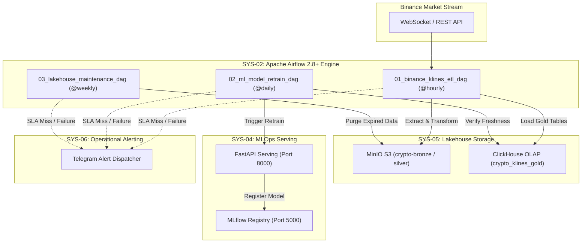

# 📚 SYS-02: COMPLETE TECHNICAL ARCHIVE

## 1. System Architecture Matrix & Lineage

---

## 2. Component Specifications

### Custom Operators (`src/sys02_orchestration/operators/`)
- `LakehouseTaskOperator`: Handles Parquet conversion, deduplication, and S3 retention purging.
- `ClickHouseTaskOperator`: Handles Time-Series SQL execution and freshness checking.

### Monitoring & Quality Utilities (`src/sys02_orchestration/utils/`)
- `validate_klines_data()`: Inspects records for null close prices or negative volumes.
- `send_telegram_alert()` / `on_task_failure_callback()`: Provides SLA and failure alerting hooks.
