# 💾 SYS-05: LAKEHOUSE & DATABASE MANAGEMENT PORTAL - TECHNICAL MANUAL

> **Mã Phân Hệ**: `SYS-05`  
> **Tên Phân Hệ**: Lakehouse & Database Management Portal  
> **Phiên Bản Tài Liệu**: 2.0 (Đầy đủ từ A-Z)  
> **Thư Mục Mã Nguồn**: `e:\Graduation_Thesis\SYS-05`  
> **Môi Trường Trực Quan**: MinIO Console (`http://localhost:9001`) | ClickHouse Web UI (`http://localhost:8123`)  

---

## 🎯 1. MỤC TIÊU & KIẾN TRÚC HỆ THỐNG

### 1.1. Mục Tiêu Chiến Lược
SYS-05 đóng vai trò là **Trung Tâm Quản Trị Kho Dữ Liệu Doanh Nghiệp (Enterprise Storage & Data Catalog Engine)** trong nền tảng FinTech Enterprise Mini Company. Phân hệ chịu trách nhiệm:
1. **Lưu trữ Medallion Architecture (3 Tầng Dữ liệu S3)**:
   - **`crypto-bronze` (Raw Data)**: Lưu dữ liệu thô JSON/CSV nhận trực tiếp từ Binance APIs.
   - **`crypto-silver` (Cleaned Parquet)**: Lưu dữ liệu đã làm sạch, chuẩn hóa schema dưới dạng Parquet/Delta Lake.
   - **`crypto-gold` (Feature Store)**: Lưu các chỉ số kỹ thuật (MA, RSI, VWAP) sẵn sàng cho MLOps AI Training.
2. **Xử lý OLAP Siêu Tốc (ClickHouse Engine)**:
   - Lưu trữ dữ liệu nến tài chính OHLCV dạng cột (Columnar Storage).
   - Truy vấn SQL ad-hoc đáp ứng **Query SLA < 10ms**.
   - Tự động chống trùng lặp dữ liệu bằng `ReplacingMergeTree`.
   - Tự động tổng hợp volume giao dịch theo giờ bằng `SummingMergeTree` Materialized View.
3. **Quản trị Metadata Hệ thống (PostgreSQL 15)**:
   - Lưu trữ trạng thái DAGs của Apache Airflow và Model Registry Metadata của MLflow.

---

## 🔄 2. SƠ ĐỒ LUỒNG DỮ LIỆU MEDALLION & CLICKHOUSE

```mermaid
graph LR
    subgraph INGESTION["🌐 Ingestion Layer"]
        BINANCE["Binance WebSocket & REST API"]
    end

    subgraph MINIO_STORAGE["💾 MinIO Object Storage (S3 API)"]
        BRONZE["🥉 crypto-bronze<br/>(Raw JSON Files)"]
        SILVER["🥈 crypto-silver<br/>(Cleaned Parquet/Delta)"]
        GOLD["🥇 crypto-gold<br/>(Aggregated Feature Store)"]
    end

    subgraph CLICKHOUSE_OLAP["⚡ ClickHouse OLAP Engine"]
        CH_TABLE["crypto_klines_gold<br/>(ReplacingMergeTree)"]
        CH_MV["mv_hourly_volume<br/>(SummingMergeTree MV)"]
    end

    BINANCE -->|Raw Ingest| BRONZE
    BRONZE -->|Spark Streaming Clean| SILVER
    SILVER -->|Feature Compute| GOLD
    GOLD -->|Fast Sync| CH_TABLE
    CH_TABLE -->|Auto Aggregate| CH_MV
```



---

## 📦 3. CẤU HÌNH DOCKER SERVICES & ANH XẠ CỔNG

Phân hệ SYS-05 được đóng gói hoàn toàn trong file [`docker-compose.yml`](file:///e:/Graduation_Thesis/SYS-05/docker-compose.yml):

| Service Name | Container Name | Host Port | Internal Port | Host Storage Location (Drive E) | Mụch Đích & Đường Dẫn UI |
| :--- | :--- | :--- | :--- | :--- | :--- |
| `minio_s3` | `minio_s3` | **`9000`** | `9000` | `SYS-05/data/minio` | S3 API Service Endpoint |
| `minio_console` | `minio_s3` | **`9001`** | `9001` | `SYS-05/data/minio` | MinIO Web Console (`http://localhost:9001` - `admin123/admin123`) |
| `minio_init` | `minio_init` | N/A | N/A | N/A | One-shot job tự động khởi tạo 3 Buckets |
| `clickhouse_server` | `clickhouse_server` | **`8123`** | `8123` | `SYS-05/data/clickhouse` | ClickHouse HTTP Query UI (`http://localhost:8123` - `admin123/admin123`) |
| `clickhouse_server` | `clickhouse_server` | **`9004`** | `9000` | `SYS-05/data/clickhouse` | ClickHouse Native TCP Interface |
| `postgres` | `sys05_postgres` | **`5432`** | `5432` | `SYS-05/data/postgres` | Shared Metadata Storage (`admin123/admin123`) |

---

## 💻 4. CẤU TRÚC SQL DDL (CLICKHOUSE SCHEMAS)

File DDL được định nghĩa tại [`sql/init_clickhouse_tables.sql`](file:///e:/Graduation_Thesis/SYS-05/sql/init_clickhouse_tables.sql):

```sql
-- 1. Bảng chính lưu nến OHLCV Real-time (ReplacingMergeTree chống trùng lặp)
CREATE TABLE IF NOT EXISTS default.crypto_klines_gold (
    symbol LowCardinality(String),
    open_time DateTime64(3, 'UTC'),
    close_time DateTime64(3, 'UTC'),
    open Float64,
    high Float64,
    low Float64,
    close Float64,
    volume Float64,
    quote_asset_volume Float64,
    number_of_trades UInt32,
    sma_20 Float64,
    rsi_14 Float64,
    updated_at DateTime DEFAULT now()
)
ENGINE = ReplacingMergeTree(updated_at)
PRIMARY KEY (symbol, open_time)
ORDER BY (symbol, open_time)
SETTINGS index_granularity = 8192;

-- 2. Materialized View tự động tổng hợp Volume theo giờ
CREATE MATERIALIZED VIEW IF NOT EXISTS default.mv_hourly_volume
ENGINE = SummingMergeTree()
PRIMARY KEY (symbol, hourly_time)
ORDER BY (symbol, hourly_time)
AS SELECT
    symbol,
    toStartOfHour(open_time) AS hourly_time,
    sum(volume) AS total_volume,
    count() AS total_klines
FROM default.crypto_klines_gold
GROUP BY symbol, hourly_time;
```

---

## 🛠️ 5. HƯỚNG DẪN VẬN HÀNH & SỬ DỤNG CONG CỤ CLI

### 5.1. Khởi động Hạ tầng Docker
```bash
cd e:/Graduation_Thesis/SYS-05
docker-compose up -d --build
docker-compose ps
```

### 5.2. Chạy Công Cụ Dòng Lệnh Management CLI (`portal_cli`)
Công cụ CLI quản trị hệ thống hỗ trợ 4 lệnh chính:

1. **Kiểm tra trạng thái hệ thống (`status`)**:
   ```bash
   python -m src.sys05_lakehouse.portal_cli status
   ```
2. **Khởi tạo lại Buckets & Bảng DDL (`init`)**:
   ```bash
   python -m src.sys05_lakehouse.portal_cli init
   ```
3. **Chạy truy vấn SQL & Đo SLA Query (`query`)**:
   ```bash
   python -m src.sys05_lakehouse.portal_cli query BTCUSDT --limit 10
   ```
4. **Kiểm tra sức khỏe & Benchmark SLA (`healthcheck`)**:
   ```bash
   python -m src.sys05_lakehouse.portal_cli healthcheck
   ```

---

## 🧪 6. QUY TRÌNH KIỂM THỬ TỰ ĐỘNG (AUTOMATED TESTS)

SYS-05 đi kèm bộ kiểm thử tự động toàn diện bằng PyTest tại [`tests/test_sys05_lakehouse.py`](file:///e:/Graduation_Thesis/SYS-05/tests/test_sys05_lakehouse.py).

Để thực thi kiểm thử:
```bash
cd e:/Graduation_Thesis/SYS-05
pytest tests/test_sys05_lakehouse.py -v
```

Các kịch bản kiểm thử:
- `test_config_loading`: Nạp biến môi trường chính xác.
- `test_minio_bucket_management`: Kiểm tra việc tạo bucket và đọc/ghi dữ liệu ở 3 tầng Medallion S3.
- `test_clickhouse_ddl_and_data_flow`: Kiểm tra chạy DDL, nạp dữ liệu nến giả lập, kiểm tra tốc độ truy vấn **Query SLA < 10ms** và kiểm tra tính đúng đắn của Materialized View.

---

## 👥 7. PHÂN QUYỀN VÀ BẢNG TRUY CẬP (RBAC MATRIX)

| Vai Trò | Quyền Hạn MinIO Console | Quyền Hạn ClickHouse OLAP | Tác Vụ Thường Nhật |
| :--- | :--- | :--- | :--- |
| **Data Administrator** | Full Admin (`minioadmin`) | Read / Write / DDL | Giám sát ổ đĩa, phân quyền S3, bảo trì Index |
| **Data Engineer** | Read/Write Bronze & Silver | Read / Write Data | Chạy Spark Ingestion, nạp batch ETL |
| **AI / ML Engineer** | Read Gold Bucket | Read Gold Tables | Đọc đặc trưng huấn luyện AI (LSTM/LightGBM) |
| **Business Analyst** | None | Read-Only SQL Query | Chạy báo cáo kinh doanh ad-hoc |

---
*Tài liệu này được tự động cập nhật đồng bộ cùng mã nguồn của phân hệ SYS-05.*
